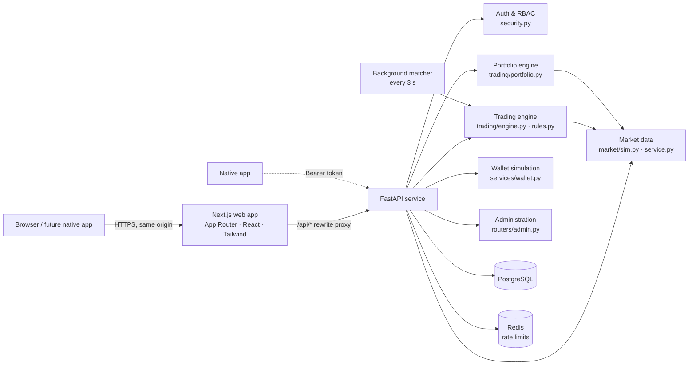

# Architecture



## Repository layout

```
kairos/
  backend/
    app/
      main.py              FastAPI app, security middleware, background matcher
      config.py            env-driven settings (KAIROS_*)
      models.py            SQLAlchemy schema
      security.py          Argon2, sessions, RBAC deps, CSRF, rate limiter
      market/              catalog.py (instruments) · sim.py (price model, Black–Scholes) · service.py (quotes, candles, chain)
      trading/             rules.py (resolution, fees, margin, position math) · engine.py (orders, fills, matching, expiry) · portfolio.py (valuation, replay)
      services/            wallet.py · settings_service.py · audit.py
      routers/             auth.py · market.py (+ WebSocket) · trading.py · admin.py
      seed.py              instruments, accounts, back-dated demo history
    alembic/               migrations
    tests/                 pytest suite (runs against PostgreSQL)
  frontend/
    src/app/               routes: public, (app) user routes, admin
    src/components/        ui (design system), layout, market, trade, portfolio, admin
    src/lib/               api client, types, formatting, live quotes
    e2e/                   Playwright walkthrough
  docker-compose.yml
```

## Separation of concerns

| Concern | Where | Notes |
|---|---|---|
| UI | `frontend/` | Client components call the API through SWR. No business rules live in the UI; previews come from the server. |
| Authentication | `security.py`, `routers/auth.py` | Opaque 256-bit session tokens, of which only the SHA-256 is stored. Cookie for web, `Authorization: Bearer` for native clients. |
| Market data | `market/` | The single source of every price. |
| Trading engine | `trading/engine.py`, `rules.py` | Validation, fills, positions, ledger. |
| Portfolio engine | `trading/portfolio.py` | Mark-to-market and historical replay. |
| Wallet | `services/wallet.py` | Simulated deposits and withdrawals; no payment details exist anywhere. |
| Administration | `routers/admin.py` | Every route depends on `require_admin`. |

Because all business logic sits behind a REST API (with Bearer-token auth), Android and iOS apps can be added without touching the core.

## Market simulation

`market/sim.py` makes each price a **pure function of (symbol, timestamp)**: fractal value-noise in log space. There are twelve octaves from 15 seconds to one year, each with amplitude ∝ σ·√period, so realised volatility matches each instrument's configured annual vol. Prices are anchored to the catalogue base price on 2026-11-01.

Consequences:

- **Consistency**: charts, quotes, the option chain, order fills, valuations and historical replays all evaluate the same function.
- **Reproducibility**: the demo is identical on every run and across server instances, with no background price process or random state.
- **Statelessness**: history at any timestamp is available instantly, which is how back-dated seeding and equity-curve replay work.

Admin overrides store `(multiplier, effective_from)` per instrument. The visible price is `raw(t) × multiplier` for `t ≥ effective_from`.

**Options** are priced with Black–Scholes (r = 6.5 %). Implied volatility has a skew/smile `base·(1 − 1.1x + 16x²)` with `x = ln(K/S)` and a slow regime drift. Expiries fall on Tuesdays at 15:30 IST: four weeklies plus monthly for NIFTY, and three monthlies for BANKNIFTY and RELIANCE. OI and volume are deterministic and peak at OTM round strikes. Contract symbols look like `NIFTY-20261110-26150-CE`.

Every API payload carries `"simulated": true`, responses carry an `X-Simulated-Data: true` header, and the UI shows a persistent *Demo · Simulated data* label.

## Trading engine

Each user operation runs in **one DB transaction that first takes `SELECT … FOR UPDATE` on the user's `accounts` row**. Concurrent orders for a user are therefore serialised, so cash, reservations, margin and positions cannot drift apart. `client_order_id` (unique per user) makes submissions idempotent.

Flow: `assess()` → business rules → `_execute()` (or rest as OPEN) → commit.

| Product | Asset classes | Cash effect | Shorting | Margin |
|---|---|---|---|---|
| DELIVERY / SPOT | stock, crypto | −qty × price on buy, +qty × price on sell | not allowed | none |
| NRML | option | premium paid or received | allowed (writing) | short: premium + max(span% × S − OTM, floor% × S) per unit; index 6.5 % / 3 %, stock 13 % / 6 % |
| MARGIN | forex | only realised P&L (converted to INR) | allowed | notional (INR) / leverage (default 1:20) |

- **Position maths**: signed quantity with weighted-average cost. Reducing realises `(price − avg) × closed × direction`; flipping through zero re-opens at the fill price.
- **Validation**: lot and min-qty multiples, tick alignment, enabled instrument, listed (unexpired) expiry, trading halt, KYC requirement, jurisdiction (INR-pairs-only), max order value, holdings (no short sell of stock/crypto, net of pending sells), option-writing switch, and **available funds after the trade ≥ 0**, where available = cash − blocked margin − reservations.
- **Rejections** are recorded as `REJECTED` orders with a reason, as brokers do. Malformed input returns 422.
- **Limit orders** rest as `OPEN` and reserve exactly the funds they would consume at the limit price. The matcher (background loop plus a pass on each portfolio/orders request) fills them at the current price once the limit is reached, re-validating at execution.
- **Fees**: `min(notional × rate, cap) + flat`, configurable per asset class by admins, and posted as separate `FEE` ledger entries.
- **Expiry**: positions in expired contracts are cash-settled at intrinsic value, timestamped at the expiry instant.
- **Risk disclosures** are produced server-side: unlimited loss (short call), large loss (short put, with the computed maximum), premium at risk (long option), leverage (forex), volatility (crypto), concentration, and resting limit.

## Portfolio engine

- **Live**: each position is marked to `mark_price()`. Equity = cash + long market value − short-option liability + forex unrealised P&L.
- **Day P&L** = equity(now) − equity(IST midnight) − external flows today.
- **Performance**: `equity_at_times()` replays ledger entries and fills in timestamp order and values positions with historical simulated prices at each sample time. The UI plots trading P&L (equity − net deposits) so deposits don't show as jumps.
- **Invariant** (covered by tests): `accounts.cash_balance == SUM(ledger_entries.amount)` for every user.

## Security

- Argon2id passwords, with a strength policy on register, reset and change.
- Sessions: random token in an httpOnly SameSite=Lax cookie (Secure flag configurable). Hash stored server-side, revocable. Revoked on logout, password reset and account disable.
- CSRF: every non-GET `/api/*` request must carry the `X-Kairos-Client` header. Browsers can't add it cross-site without a CORS preflight, which is refused unless `KAIROS_CORS_ORIGINS` is set.
- RBAC: `require_admin` dependency on the whole admin router, plus a client-side guard for UX. Admins cannot change their own role or status.
- Rate limits: Redis fixed window with in-memory fallback. Login 20/min per IP and 8 per 5 min per email; register, forgot and reset are limited; orders 40/min per user; wallet 20/min.
- Input validation with Pydantic (lengths, patterns, decimal precision) and server-side order validation.
- Audit log: logins and failures, registration, orders, cancellations, wallet movements, profile and KYC changes, and every admin action (with before/after details).
- Security headers on both tiers (nosniff, frame deny, referrer policy, permissions policy). No secrets in frontend code; the demo-user credential shown on the login page is public by design.
