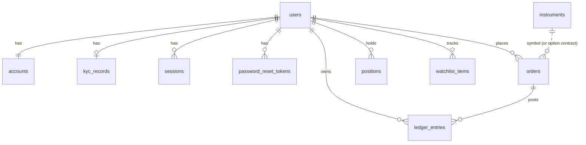

# Database schema

PostgreSQL 16, managed by Alembic (`backend/alembic/versions`). Money is `NUMERIC(20,4)`; prices and quantities are `NUMERIC(24,8)`. Timestamps are `timestamptz` (UTC). IDs are 32-character hex UUIDs.



| Table | Purpose | Key columns |
|---|---|---|
| `users` | Identity and role | `email` unique, `password_hash` (Argon2id), `role` user/admin, `status` active/disabled, `is_seed`, `preferences` JSON, `last_login_at`, `last_seen_at` |
| `accounts` | One INR cash account per user | `cash_balance`. **Row-locked for every money-moving operation**; always equals Σ ledger |
| `sessions` | Server-side sessions | `token_hash` (SHA-256) unique, `expires_at`, `revoked_at`, `ip`, `user_agent` |
| `password_reset_tokens` | Single-use reset links | `token_hash`, `expires_at`, `used_at` |
| `kyc_records` | Simulated KYC | `status` NOT_SUBMITTED/PENDING/APPROVED/REJECTED, `pan_masked` (never the full value), review fields |
| `instruments` | Tradable and reference catalogue | `symbol` PK, `asset_class` stock/crypto/forex/index, `currency` (quote ccy), `base_price`, `volatility`, `decimals`, `tick_size`, `lot_size`, `min_qty`, `enabled`, `tradable`, `has_options`, `price_multiplier` + `override_from` (admin override), `meta` JSON (base volume, option config: lot size, strike step, base IV, span %) |
| `orders` | Order and fill record | `symbol` (instrument or option contract), `asset_class`, `side`, `order_type` MARKET/LIMIT/EXPIRY, `product`, `quantity` (units), `limit_price`, `status` OPEN/FILLED/CANCELLED/REJECTED, `filled_price`, `filled_at`, `fees`, `reserved_amount`, `realized_pnl`, `reject_reason`, unique (`user_id`, `client_order_id`) |
| `positions` | Net position per user and symbol | signed `quantity`, `avg_price`, cumulative `realized_pnl` (INR), `margin_blocked`, unique (`user_id`, `symbol`) |
| `ledger_entries` | Append-only cash ledger | `type` DEPOSIT, WITHDRAWAL, TRADE_BUY, TRADE_SELL, OPTION_PREMIUM_PAID, OPTION_PREMIUM_RECEIVED, FX_PNL, FEE, EXPIRY_SETTLEMENT; signed `amount`; `balance_after`; `reference`; `order_id`; `method` |
| `watchlist_items` | Watchlist | unique (`user_id`, `symbol`) |
| `platform_settings` | Admin-editable JSON sections | `fees`, `trading`, `wallet` (merged over code defaults) |
| `audit_logs` | Audit trail | `actor_id`, `actor_email`, `action`, `target_type`, `target_id`, `details` JSON, `ip` |

Derived values (available cash, reserved funds, equity, P&L) are computed, not stored, apart from the per-position `margin_blocked` snapshot.

## Migrations and seed

```bash
cd backend
.venv/bin/alembic upgrade head        # apply
.venv/bin/alembic revision --autogenerate -m "..."   # after model changes
.venv/bin/python -m app.seed          # idempotent
.venv/bin/python -m app.seed --reset  # rebuild the demo user's history
```
